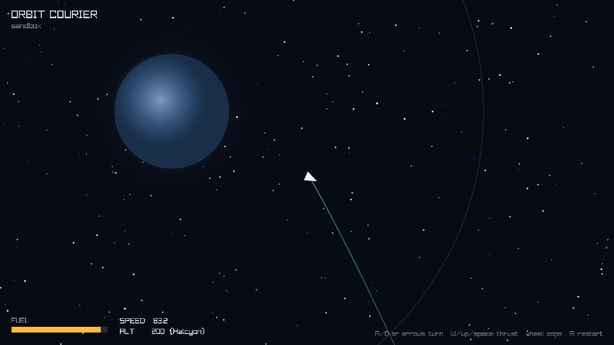

# Orbit Courier

[](https://github.com/gigantic536wall/orbit-courier/actions/workflows/ci.yml)

A small space game about delivering parcels between moons with a weak engine and a lot of gravity.
Written in modern C++20 with [raylib](https://www.raylib.com/), it runs natively on Windows, Linux and macOS and in the browser via WebAssembly.

**▶ Play in the browser:** [gigantic536wall.github.io/orbit-courier](https://gigantic536wall.github.io/orbit-courier/)

> 🚧 Work in progress: the flight model and the sandbox are done; deliveries, levels and scoring come next.

<p align="center"></p>

## Gameplay

You fly a tiny courier drone. Planets and moons pull it around, the engine is weak and fuel is scarce,
so the trick is to use gravity: fall towards a planet to speed up, and let orbits do the work.
A live trajectory preview shows where you will go if you cut the engine.

| Key | Action |
| --- | --- |
| A / D or ← / → | Turn |
| W, ↑ or Space | Thrust |
| Mouse wheel | Zoom |
| R | Restart |

## Engineering highlights

- **Deterministic simulation:** fixed 120 Hz time step, independent of the frame rate; the same inputs always give the same flight (covered by tests).
- **Physics that holds up:** velocity Verlet (a symplectic integrator) keeps orbits stable over thousands of laps; tests check energy conservation and that a circular orbit closes after one period.
- **Moons on rails:** celestial bodies follow analytic orbits, so only the ship is integrated and the trajectory preview is exact (tested against the real flight).
- **Clean separation:** all game rules live in `oc_core`, a library without any graphics dependency; the raylib front end only reads input and draws.
- **Strict build:** C++20, warnings as errors (`/W4 /WX`, `-Wall -Wextra -Wconversion -Werror`), no fused multiply-add for reproducible floating point.
- **CI on three platforms** (Windows/MSVC, Linux/GCC, macOS/Clang) plus an Emscripten build that is deployed to GitHub Pages on every push.

## Build

Requirements: CMake 3.25+, a C++20 compiler. raylib and doctest are downloaded automatically.

```bash
cmake --preset release          # or: cmake -B build -DCMAKE_BUILD_TYPE=Release
cmake --build --preset release
ctest --preset release
./build/release/src/game/orbit_courier
```

On Linux install the X11/OpenGL headers first (`libx11-dev libxrandr-dev libxinerama-dev libxcursor-dev libxi-dev libgl1-mesa-dev`).

Browser build (with the [Emscripten SDK](https://emscripten.org/) activated):

```bash
emcmake cmake -B build-web -DCMAKE_BUILD_TYPE=Release -DOC_BUILD_TESTS=OFF
cmake --build build-web
python -m http.server -d build-web/src/game   # open http://localhost:8000
```

## Project layout

```
src/core/   game rules: vectors, bodies, ship, physics, levels (no graphics)
src/game/   raylib front end: input, camera, rendering, main loop
tests/      doctest unit tests for the core
web/        HTML shell for the WebAssembly build
```

## Roadmap

- [x] Flight model, gravity, collisions, trajectory preview, sandbox, CI + web build
- [ ] Deliveries, fuel economy, levels and scoring
- [ ] Menus, effects, synthesized sound, saved progress, touch controls
- [ ] Release builds for Windows/Linux/macOS

## License

MIT. raylib is under the zlib license.
