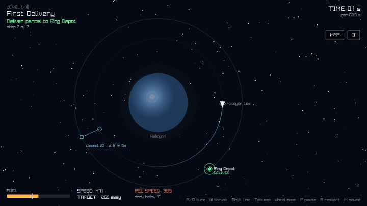
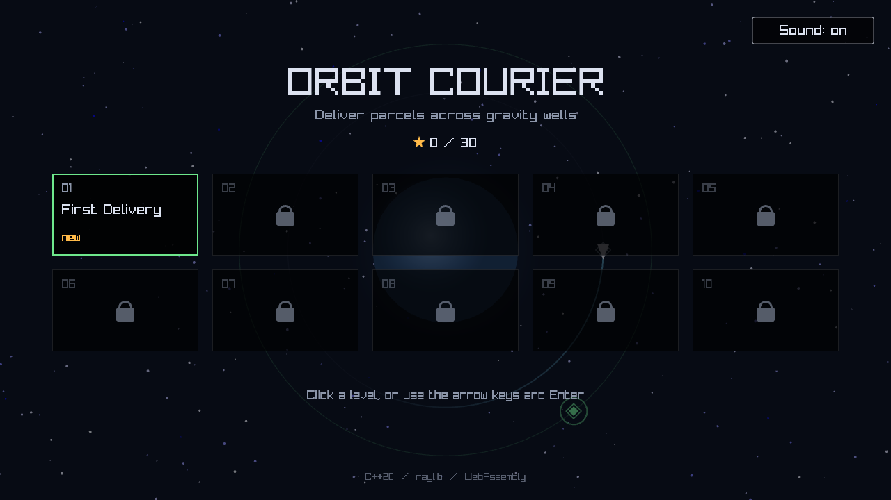

# Orbit Courier

[](https://github.com/gigantic536wall/orbit-courier/actions/workflows/ci.yml)

A small space game about delivering parcels between moons with a weak engine and a lot of gravity.
Written in modern C++20 with [raylib](https://www.raylib.com/), it runs natively on Windows, Linux and macOS and in the browser via WebAssembly.

**▶ Play in the browser:** [gigantic536wall.github.io/orbit-courier](https://gigantic536wall.github.io/orbit-courier/)  
**⬇ Download** for Windows, macOS and Linux: [latest release](https://github.com/gigantic536wall/orbit-courier/releases/latest)

<p align="center"></p>
<p align="center"><sub>Recorded from the game itself: the built-in autopilot flies level 1 with a single burn (<code>OC_RECORD=1</code>).</sub></p>
<p align="center"></p>

## Gameplay

You fly a tiny courier drone between stations that orbit planets and moons. The engine is weak and fuel is
scarce, so the trick is to use gravity: fall towards a planet to speed up, and let orbits do the work.

- **Dock** by getting within reach of the target station at a low relative speed (the HUD turns green).
- **Plan** with the live trajectory preview: it shows where you will coast, where you would crash, and the
  point where you will pass closest to the target, with the distance and relative speed at that moment.
- **Ten levels**, from a first orbit raise to retrograde stations, two moons, a double planet and a slingshot
  to the edge of the system.
- **Three stars** per level: deliver everything, beat the par time, and keep enough fuel. Progress is saved
  (a file on desktop, `localStorage` in the browser) and each level unlocks the next.
- **Sound and effects:** every sound is synthesized in code at start-up (no audio files); exhaust, debris and
  docking sparks are particles.
- **Phones and tablets:** on-screen flight controls appear on the first touch.

| Key | Action |
| --- | --- |
| A / D or ← / → | Turn |
| W, ↑ or Space | Thrust |
| Shift (held) | Fine thrust for docking |
| Tab | System map |
| Mouse wheel | Zoom |
| P / Esc | Pause |
| R | Restart the level |
| M | Sound on / off |
| [ / ] | Previous / next level (in the briefing) |

## Engineering highlights

- **Deterministic simulation:** fixed 120 Hz time step, independent of the frame rate; the same inputs always give the same flight (covered by tests).
- **Physics that holds up:** velocity Verlet (a symplectic integrator) keeps orbits stable over thousands of laps; tests check energy conservation and that a circular orbit closes after one period.
- **Moons and stations on rails:** celestial bodies and stations follow analytic orbits (positions and velocities), so only the ship is integrated and the trajectory preview is exact (tested against the real flight).
- **Levels that are proven winnable:** a test autopilot flies textbook Hohmann transfers (wait for the phase angle, one burn, coast) and must dock and earn the expected stars; other tests check that every level starts in a safe orbit, that no station passes through a body, and that the fuel budget is at least 3x the ideal transfer.
- **Robust saves:** the progress format is versioned, written atomically on desktop, and the parser ignores damaged or foreign data (tested), so a bad save can never crash the game.
- **Clean separation:** all game rules live in `oc_core`, a library without any graphics dependency; the raylib front end only reads input and draws.
- **Strict build:** C++20, warnings as errors (`/W4 /WX`, `-Wall -Wextra -Wconversion -Werror`), no fused multiply-add for reproducible floating point.
- **CI on three platforms** (Windows/MSVC, Linux/GCC, macOS/Clang) plus an Emscripten build that is deployed to GitHub Pages on every push.
- **Releases from a tag:** pushing `v*` builds Windows (static runtime, no installer), a universal macOS binary, Linux and a web package, runs the tests on each, and publishes them as a GitHub Release.

## Build

Requirements: CMake 3.25+, a C++20 compiler. raylib and doctest are downloaded automatically.

```bash
cmake --preset release          # or: cmake -B build -DCMAKE_BUILD_TYPE=Release
cmake --build --preset release
ctest --preset release
./build/release/src/game/orbit_courier
```

On Linux install the X11/OpenGL headers first (`libx11-dev libxrandr-dev libxinerama-dev libxcursor-dev libxi-dev libgl1-mesa-dev`).

Browser build (with the [Emscripten SDK](https://emscripten.org/) activated):

```bash
emcmake cmake -B build-web -DCMAKE_BUILD_TYPE=Release -DOC_BUILD_TESTS=OFF
cmake --build build-web
python -m http.server -d build-web/src/game   # open http://localhost:8000
```

## Project layout

```
src/core/   game rules: physics, stations, missions, scoring, levels (no graphics)
src/game/   raylib front end: screens and input (app), drawing (render), synthesized audio, particles, storage
tests/      doctest unit tests for the core
web/        HTML shell for the WebAssembly build
```

## Roadmap

- [x] Flight model, gravity, collisions, trajectory preview, sandbox, CI + web build
- [x] Stations, docking, deliveries, ten levels, scoring and stars
- [x] Level select, saved progress, synthesized sound, particles, touch controls (38 test cases)
- [x] Release builds for Windows, Linux and macOS (GitHub Actions, on every version tag)

## License

MIT. raylib is under the zlib license.
